<div align="center">


# Hankki-Ttukttak (한끼뚝딱)

**Whip up today's meal from what's in your fridge — ingredient tracking · recipe recommendation · lowest-price grocery finder**

🏆 **Grand Prize (1st place), Gumi Class 1 — SSAFY 15th cohort, 1st-semester capstone project**

[한국어](README.md) · **English**


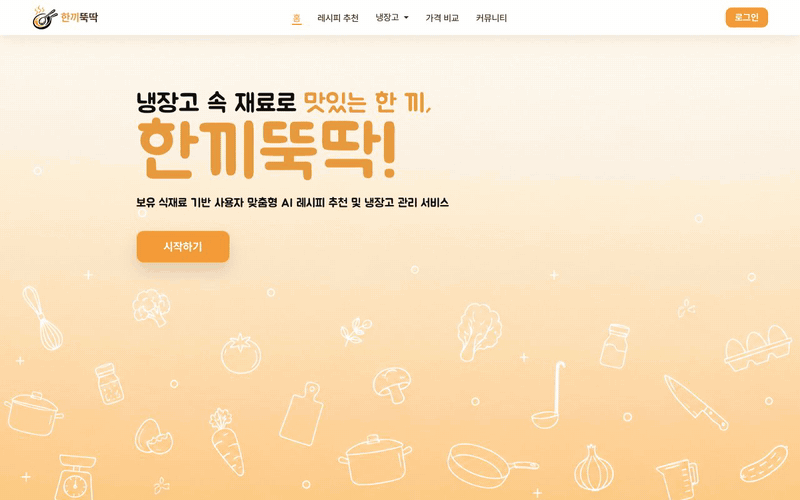

</div>

---

## Contents
1. [Overview](#1-overview)
2. [Team & Roles](#2-team--roles)
3. [Tech Stack & Architecture](#3-tech-stack--architecture)
4. [Features](#4-features)
5. [Recommendation Algorithm](#5-recommendation-algorithm)
6. [Data & ERD](#6-data--erd)
7. [Getting Started](#7-getting-started)

---

## 1. Overview

| Item    | Details                                                                 |
| :------ | :---------------------------------------------------------------------- |
| Period  | 2026.05 – 2026.06                                                       |
| Team    | 2 (Jihwan Shin, Seungjun Hyun — both full-stack)                        |
| Program | SSAFY 15th cohort, 1st-semester capstone project (Gumi Class 1, Team 7) |
| Award   | 🏆 **Grand Prize, Gumi Class 1**                                         |

### Problem
- People have ingredients in the fridge but **don't know what to cook**, so food goes to waste.
- Even with a recipe in hand, it's hard to know **where and at what price** to buy the missing ingredients.
- Logging groceries into an app one by one is tedious.

### Solution
| Problem                 | How Hankki-Ttukttak solves it                                                                |
| :---------------------- | :------------------------------------------------------------------------------------------- |
| Don't know what to cook | **100-point recommendation engine** on owned ingredients + diet/allergy-aware **AI recipes** |
| Food waste              | **Alerts** and priority display for ingredients near their expiry date                       |
| Tedious input           | Register groceries from **a single receipt photo** (OCR + LLM)                               |
| Grocery costs           | **Lowest-price comparison + map** across stores in your area                                 |

---

## 2. Team & Roles

<table>
  <tr>
    <td align="center" width="50%">
      <br />
      <b>Jihwan Shin</b><br />
      Full-stack · UI/UX<br />
      <a href="https://github.com/jihwan4155">GitHub</a>
    </td>
    <td align="center" width="50%">
      <br />
      <b>Seungjun Hyun</b><br />
      Full-stack · AI / External APIs<br />
      <a href="https://github.com/sejhyun13">GitHub</a>
    </td>
  </tr>
</table>

### Jihwan Shin
- **Recommendation engine**: combined recipe/user coverage, popularity and dish-type weights, penalties for trivial recipes → 100-point normalized score
- **Community**: post/comment CRUD, drafts with resume-writing, hashtag and category routes
- **Users**: onboarding (allergies, diet, region), My Page, other users' profiles, follow
- **Home content**: random recipe of the day, top-5 popular recipes, YouTube recipes, recipe crawler improvements
- **UI/UX design**: Figma prototype, color and font theme, mascots (hamster and penguin), landing and home dashboard
- **Performance**: removed N+1 queries with `annotate(Count)` · `select_related` · `Prefetch`, shared querysets
- **Data**: `bulk_create`-based bulk fixture loading command, demo dummy data

### Seungjun Hyun
- **Lowest price & map**: Korea Consumer Agency price OpenAPI, nationwide store/product catalog cache, coordinate anomaly normalization, Kakao Maps markers and overlays
- **Receipt → fridge**: line reconstruction from CLOVA OCR coordinates + LLM cleanup + matching to standard ingredients
- **AI recipes**: diet/allergy prompt injection, structured JSON responses, result caching, LLM diet review, OpenAI (gpt-image-1-mini) image generation
- **Auth**: token auth, Kakao · Naver · Google OAuth2 Authorization Code flow
- **Frontend**: ingredient picker (category themes, async loading of 1,000 icons), responsive layout
- **Performance**: composite index migration, fewer queryset evaluations in recommendations, Vite code splitting
- **Other**: one-shot demo setup (`setup_demo`), terms and legal pages, brand assets

### Together
- Recommendation formula design and tuning, planning · DB modeling · presentation

---

## 3. Tech Stack & Architecture

| Area          | Technologies                                                                                                |
| :------------ | :---------------------------------------------------------------------------------------------------------- |
| Backend       | Python 3.11, Django 5.2, Django REST Framework, dj-rest-auth, django-allauth, SQLite                        |
| Frontend      | Vue 3, Vue Router, Vite, Fetch API                                                                          |
| AI            | OpenAI API — receipt cleanup · recipe generation · diet/post review (GPT), recipe images (gpt-image-1-mini) |
| External APIs | NAVER CLOVA OCR, Korea Consumer Agency price OpenAPI, Kakao Maps JS SDK, Kakao/Naver/Google OAuth           |
| Collaboration | GitLab, Figma                                                                                               |

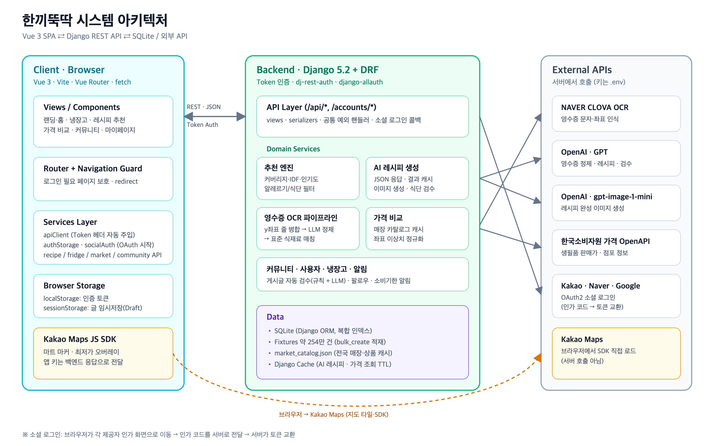

---

## 4. Features

### 4-1. Landing & Home Dashboard

|                   Landing                   |            Home dashboard             |
| :-----------------------------------------: | :-----------------------------------: |
|  | 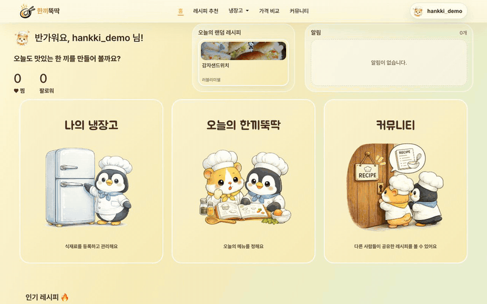 |

- Random recipe of the day, top-5 popular recipes, star chefs, category shortcuts
- Banner for ingredients close to expiry

### 4-2. Sign-up · Social Login · Onboarding

|                  Login                  |                    Onboarding                     |
| :-------------------------------------: | :-----------------------------------------------: |
| 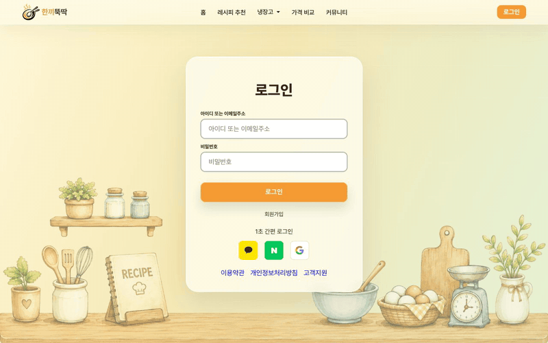 | 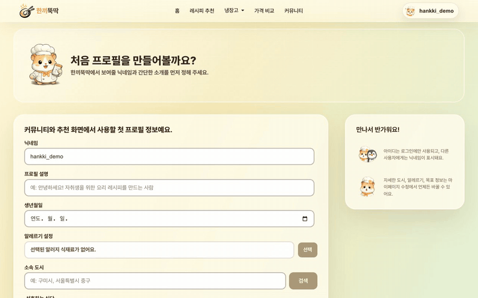 |

- Kakao · Naver · Google OAuth2 (authorization code in the browser, token exchange on the server)
- Allergies, diet and region are set right after sign-up and applied to recommendations and price comparison

### 4-3. Fridge Management & Expiry Alerts

|                 My fridge                 |                    Add ingredients                     |
| :---------------------------------------: | :----------------------------------------------------: |
| 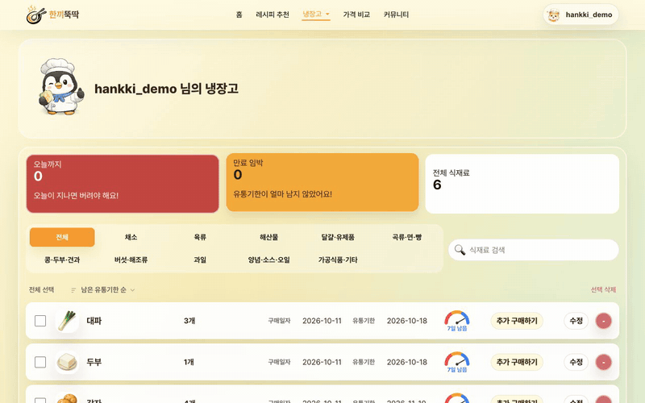 | 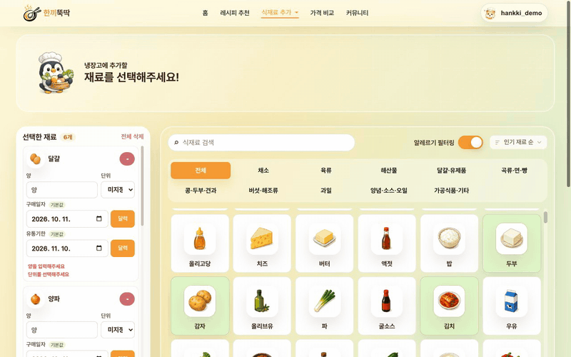 |

- 1,000 standard ingredients with a category-based icon picker
- D-day countdown to expiry; items with 5 days or less are shown first

### 4-4. Receipt OCR Auto-registration ⭐

<p align="center">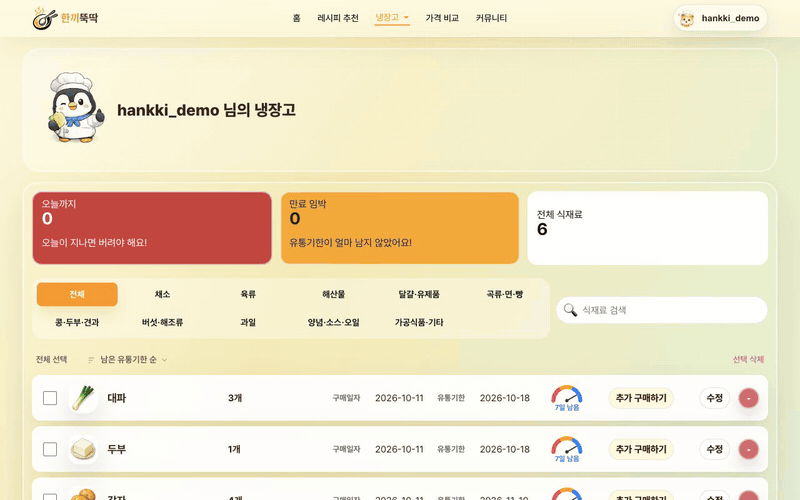</p>

- Rebuilds item rows by **merging CLOVA OCR bounding boxes along the y-axis**
- An LLM structures `국산 삼겹살 500g` (domestic pork belly 500g) into `삼겹살 / 500 / g` and drops noise such as delivery fees and loyalty points
- Matches items to standard ingredients via an alias table (100k+ spellings), then adds them in bulk

### 4-5. Ingredient-based Recipe Recommendation ⭐

|                      Pick ingredients                      |                      Results                       |
| :--------------------------------------------------------: | :------------------------------------------------: |
| 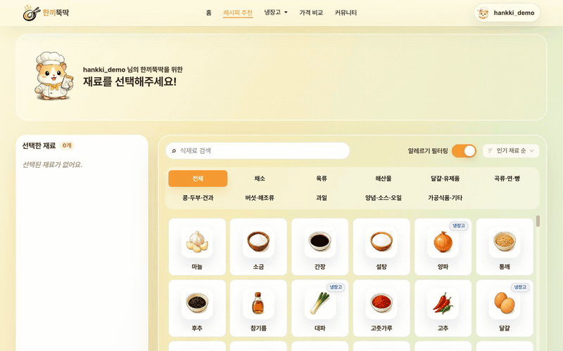 | 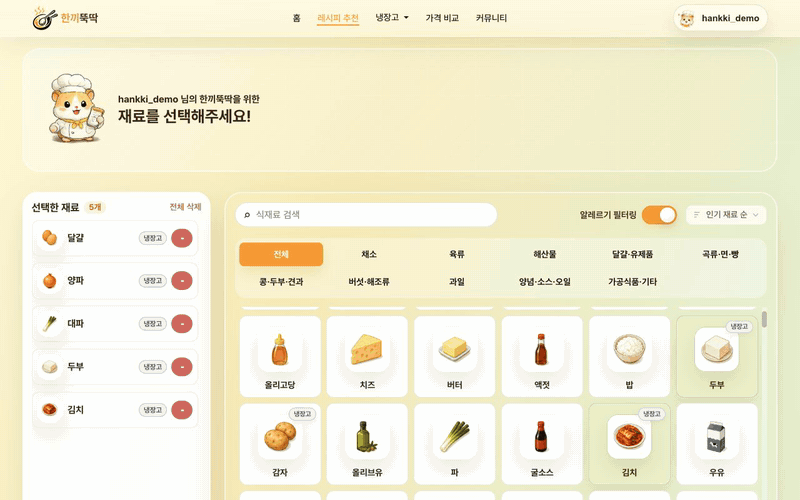 |

- Matching (IDF-weighted) + popularity + dish type − penalties → **100-point normalized score** ([details](#5-recommendation-algorithm))
- Allergens and diet-restricted ingredients are excluded at query time, with a second check by LLM diet review

### 4-6. Personalized AI Recipes & Images ⭐

|                    Generating                     |                     Result                      |
| :-----------------------------------------------: | :---------------------------------------------: |
| 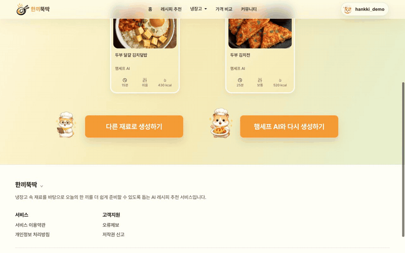 | 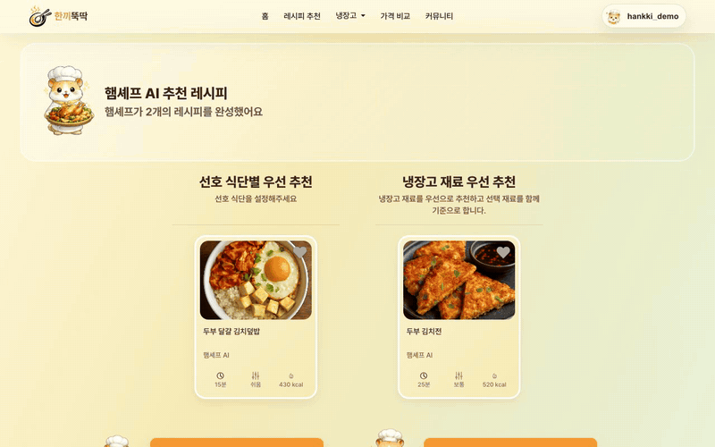 |

- Fridge ingredients, diet and allergies are injected into the prompt; the response is locked to a JSON schema
- Identical requests are served from cache to cut cost and latency
- Finished-dish images are generated from an LLM-written English image prompt (OpenAI gpt-image-1-mini, about $0.005 per image); identical prompts are reused from a file cache

### 4-7. Lowest Price & Store Map ⭐

|                      Price comparison                      |                 Store map                  |
| :--------------------------------------------------------: | :----------------------------------------: |
| 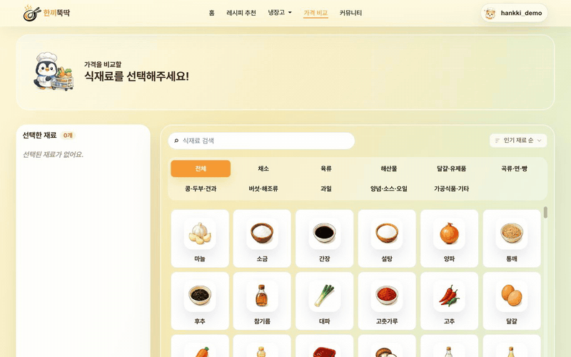 | 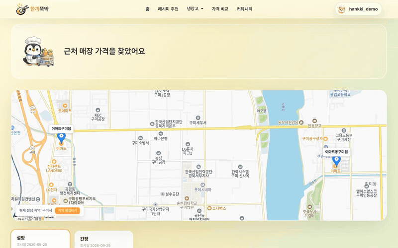 |

- Missing recipe ingredients or fridge restock items → total cost per store in your region
- Normalizes public-data anomalies such as swapped lat/lng and `(1,1)` dummy coordinates
- Unmatched items get a guide modal, and the rest of the app keeps working even if the price API fails

### 4-8. Community

|                      Main                       |                    Write a post                    |                       Detail                        |
| :---------------------------------------------: | :------------------------------------------------: | :-------------------------------------------------: |
| 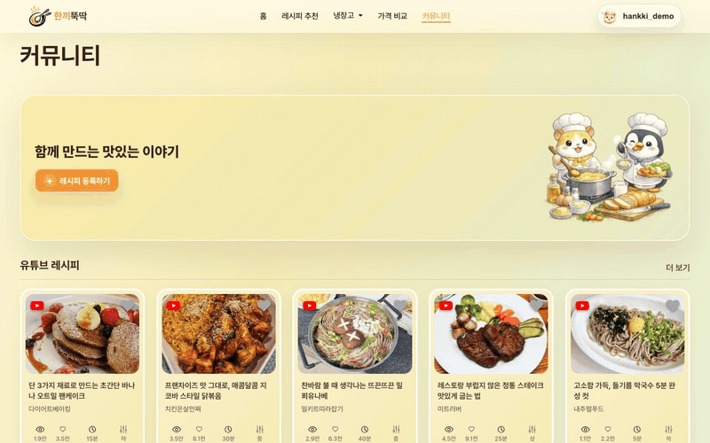 | 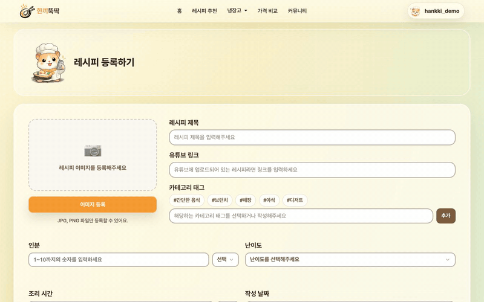 | 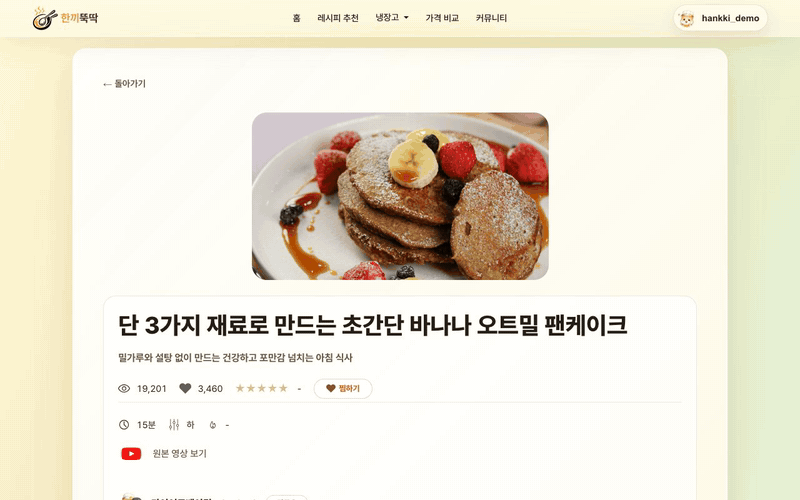 |

- Recipe post CRUD, comments, likes, hashtags, follow
- **Drafts & resume-writing** so nothing is lost mid-post
- **Automatic post review** before publishing, using rules plus an LLM (blocks profanity and non-cooking posts)
- YouTube recipe videos

### 4-9. My Page

|                  My Page                   |                     User profile                      |
| :----------------------------------------: | :---------------------------------------------------: |
| 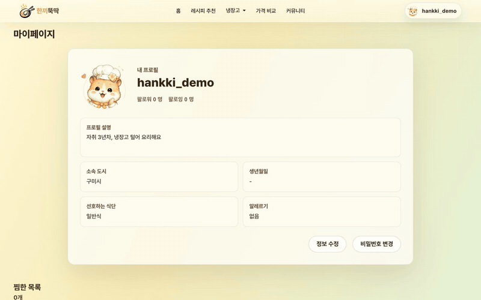 | 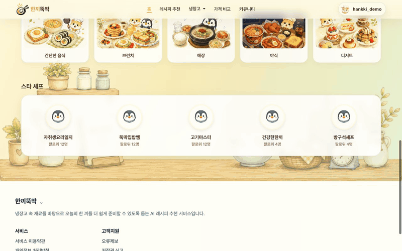 |

- Saved recipes and posts, own posts, followers/following, profile edit · password change · account deletion

---

## 5. Recommendation Algorithm

$$S_{\text{final}} = \text{clip}_{[0,100]}\left(S_{\text{match}} + S_{\text{popularity}} + S_{\text{type}} - P_{\text{penalty}}\right)$$

| Factor     | Points | Description                                                          |
| :--------- | :----: | :------------------------------------------------------------------- |
| Matching   |   30   | Recipe coverage 15 + IDF-weighted user coverage 15                   |
| Popularity |   40   | (scraps + recommendations) / max among candidates                    |
| Dish type  |   30   | Main meals 30 / sauces · drinks · desserts 10                        |
| Penalty    |   −    | Title keywords (sauce, seasoning, …) −20, 2 or fewer ingredients −15 |

- Pre-filter: drop recipes containing allergens or ingredients forbidden by the diet preset (vegan · lacto · ovo)
- IDF: $IDF_i = \ln\left(1 + \frac{N}{\max(DF_i, 1)}\right)$ — matching beef or squid counts for more than salt or water

---

## 6. Data & ERD

| Data                                   | Size    |
| :------------------------------------- | :------ |
| Recipes (cleaned from 10000recipe.com) | 234,538 |
| Recipe–ingredient links                | ~2.1M   |
| Ingredient aliases                     | 106,994 |
| Total fixtures                         | ~2.54M  |

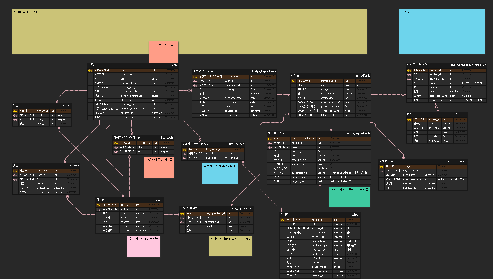

See [ERD.md](ERD.md) (Korean) for the full schema.

---

## 7. Getting Started

```bash
# 1) Environment variables (-n keeps an existing .env)
cp -n .env.example .env   # then fill in your API keys

# 2) Backend
cd backend
python -m venv .venv && source .venv/bin/activate
pip install -r requirements.txt
python manage.py setup_demo     # migrations + bulk demo data load
python manage.py runserver

# 3) Frontend
cd ../frontend
npm install
npm run dev                     # http://localhost:5173
```

See [.env.example](.env.example) for the variables. The server starts without API keys; only the features that need them are disabled.
